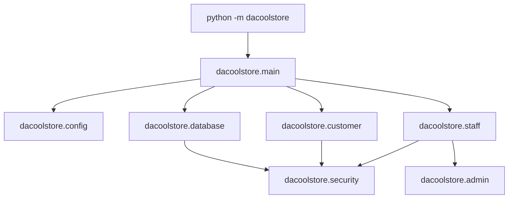

# System Architecture - Da Cool Store

This document describes the high-level architecture of the **Da Cool Store** desktop application.

---

## 🏗️ Architectural Overview

Da Cool Store is a desktop-based Point of Sale (POS) and inventory management utility built on a client-server relational model. The presentation layer is driven by **PySimpleGUI (Tkinter)**, while the data persistence layer is handled by **MySQL Server 8+**.

The codebase is structured as a standard Python package (`dacoolstore/`) to ensure modularity, clear separation of concerns, and ease of deployment.



---

## 🧩 Component Breakdown

### 1. Main Entrypoint (`dacoolstore/main.py`)
Acts as the central router and application controller.
*   Runs table creation check and inserts demo data.
*   Orchestrates the top-level welcome loop.
*   Coordinates window changes by showing, hiding, and recreating window definitions.

### 2. Database Module (`dacoolstore/database.py`)
Handles connection instantiation, table schema definitions, and SQL queries.
*   Queries use parameterized placeholders (`%s`) to protect against SQL injections.
*   Resource-safe: Connection cursors are guaranteed to close using `try...finally` structures.

### 3. Security Utility (`dacoolstore/security.py`)
Houses cryptographic routines for safeguarding customer and employee passwords.
*   Uses PBKDF2-HMAC-SHA256 with standard unique salts.
*   Provides fallback checks to allow legacy (unhashed/plain-text) records to authenticate successfully.

### 4. Configuration Manager (`dacoolstore/config.py`)
Loads credentials securely.
*   Reads `.env` configurations using `python-dotenv`.
*   Falls back to local development presets.

### 5. UI Layout Modules (`customer.py`, `staff.py`, `admin.py`)
Contain layout blueprints, tables, form components, and local event loops.

---

## 🔄 GUI Event Flow & Loop Orchestration

### The Legacy Problem (Circular/Recursive Stack Leaks)
In the original application, window navigation was executed by having windows launch other windows recursively. For example:
`main()` ➔ calls `staff_login_window()` ➔ click Back ➔ calls `main()` ➔ click Staff ➔ calls `staff_login_window()`.

Each call added a new PySimpleGUI event loop and Tkinter window frame to the memory stack. This caused the application to crash, leak database connections, and require clicking "Exit" multiple times to terminate the process.

### The Modern Solution (Linear Return Flow)
The modernized design structures all UI sub-windows to act as blocking, callable subroutines. When a sub-window task is completed or the user clicks "Back", the function simply breaks its event loop, closes its Tkinter resources, and **returns control back to the caller**.

```
[dacoolstore.main]
   │
   ├──► [customer_login_window]
   │       │
   │       └──► [customer_order_window] (returns back on logout)
   │
   └──► [staff_login_window]
           │
           └──► [admin_window] (returns back on logout)
```

No recursive imports are performed, the execution stack remains flat, and clicking "Exit" closes the application instantly.
