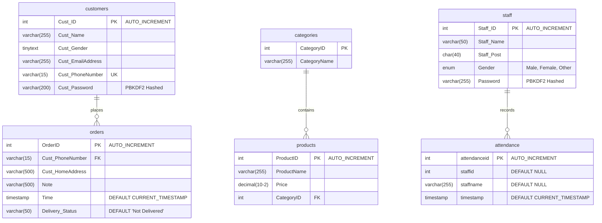

# Database Schema Documentation - Da Cool Store

This document outlines the database schema, table columns, and data relationships for the **Da Cool Store** application.

---

## 📊 Database Schema Entity-Relationship Map

---

## 🗄️ Tables Specification

### 1. `customers`
Stores customer registration profiles.
*   `Cust_PhoneNumber` is enforced as unique and serves as the key for linking orders and looking up user logins.
*   `Cust_Password` stores PBKDF2-HMAC-SHA256 hashes (originally plain text).

### 2. `orders`
Stores order records.
*   `Cust_PhoneNumber` acts as a Foreign Key linked to the `customers` table.
*   `Delivery_Status` is used by staff/admins to monitor fulfillment. Can be updated between `'Not Delivered'` and `'Delivered'`.

### 3. `categories`
Stores product categories.
*   Pre-populated with default categories: `Groceries (1)`, `Books (2)`, `Clothing (3)`, and `Stationery (4)`.

### 4. `products`
Stores inventory stock records.
*   `CategoryID` is a Foreign Key referencing `categories.CategoryID`.
*   Includes cascade deletion protections (cannot delete a category if products are still assigned to it).

### 5. `staff`
Stores employee records.
*   Includes default demo roles (e.g., `Akhil Tyagi` as CEO, `Priya Sharma` as Manager).
*   Password hashes are stored securely.

### 6. `attendance`
Stores log entries marking employee attendance logs.
*   `timestamp` is populated automatically on record creation.

---

## 🔄 Automated Setup & Seed Data
*   **Auto-Migration**: Upon application boot, the database connector queries the MySQL catalog for missing tables and builds them automatically.
*   **Seed Records**: If tables are empty, default records are seeded (including CEO and manager records, categories, and initial product entries).
